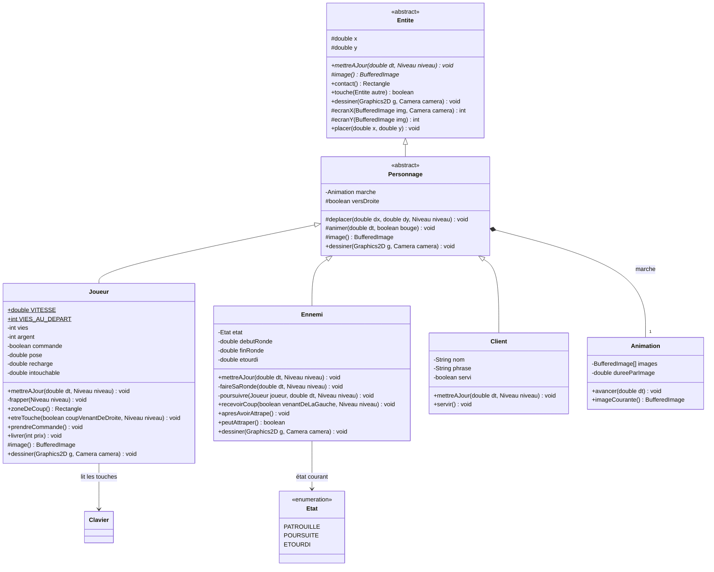
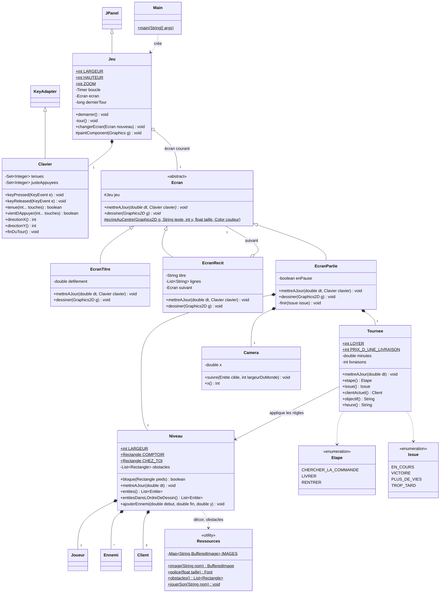
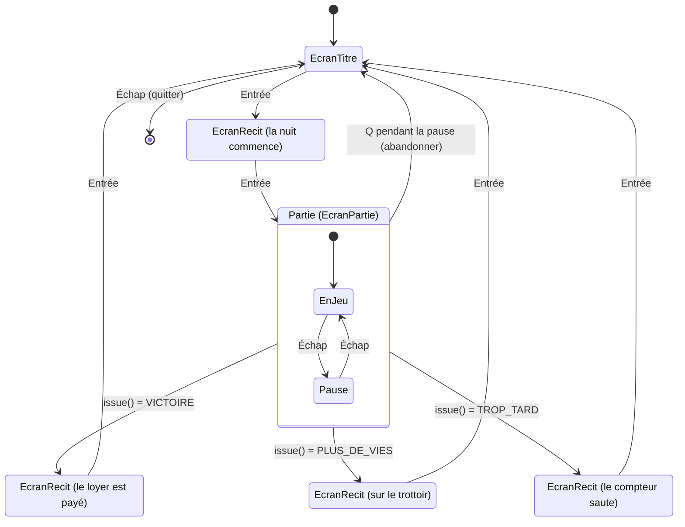
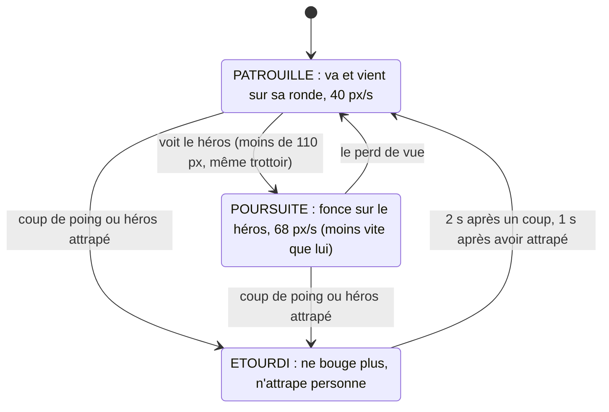
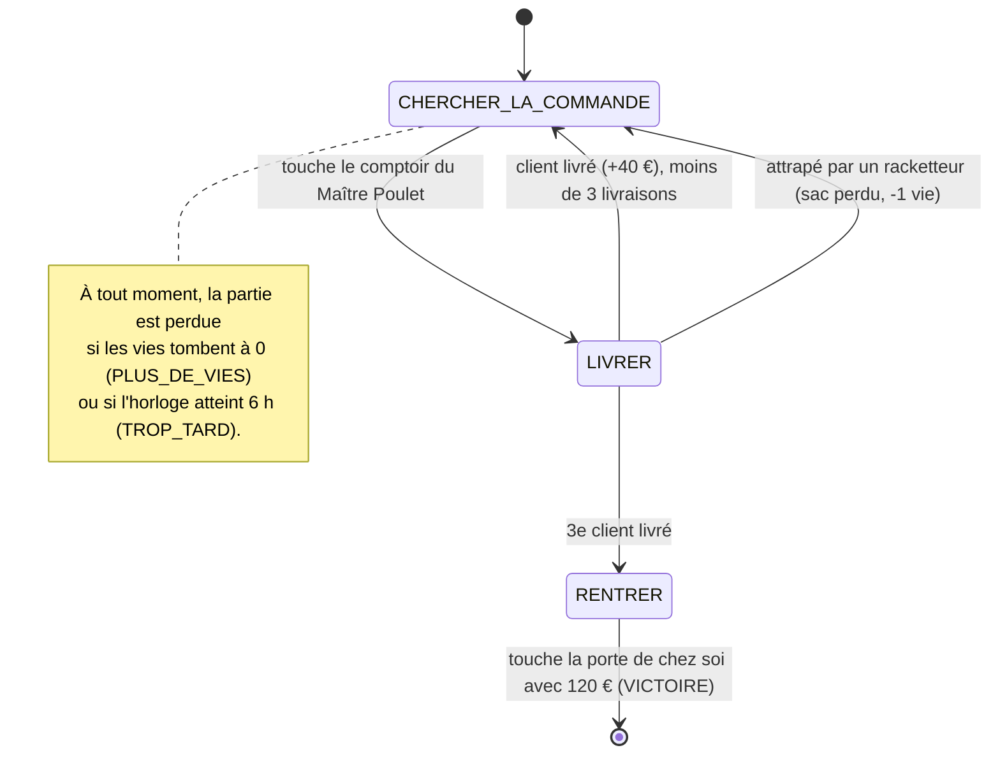
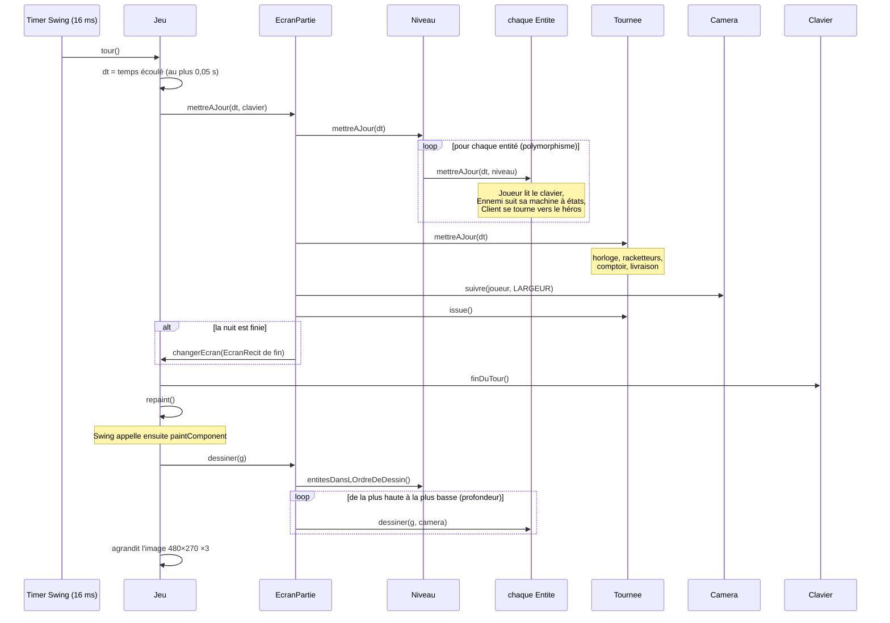

# GET A JOB — conception (UML)

Les diagrammes sont écrits en [Mermaid](https://mermaid.js.org/) : GitHub les affiche directement.
Ils décrivent le code de `src/getajob/`, réparti en quatre packages : `moteur`, `entites`, `monde` et `ecrans`.

1. [Diagramme de classes : les entités](#1-diagramme-de-classes--les-entités)
2. [Diagramme de classes : le jeu, les écrans et les règles](#2-diagramme-de-classes--le-jeu-les-écrans-et-les-règles)
3. [Diagrammes d'états](#3-diagrammes-détats) (le jeu, un racketteur, la tournée)
4. [Diagramme de séquence : un tour de boucle](#4-diagramme-de-séquence--un-tour-de-boucle)
5. [Les design patterns utilisés](#5-les-design-patterns-utilisés)

---

## 1. Diagramme de classes : les entités

Tout ce qui vit dans l'avenue est une `Entite`. Tout ce qui marche est un `Personnage`.
Les trois sous-classes ne diffèrent que par **leur façon de décider** (`mettreAJour`) et **de se montrer** (`image`, `dessiner`).

**Points clés :**
- `deplacer` (collisions et glissement) n'est écrit **qu'une fois**, dans `Personnage`. Le joueur, les racketteurs et les clients s'en servent tous.
- `mettreAJour` est **abstraite** : chaque sous-classe doit dire comment elle se comporte.
  - Le `Joueur` obéit au clavier.
  - L'`Ennemi` suit sa machine à états.
  - Le `Client` se tourne vers le héros.
- `Joueur` et `Ennemi` **redéfinissent** `dessiner` en appelant d'abord `super.dessiner`, puis ajoutent leur détail : le sac pour le joueur, les étoiles pour le racketteur étourdi.

---

## 2. Diagramme de classes : le jeu, les écrans et les règles

`Jeu` ne connaît qu'un `Ecran` abstrait : c'est l'écran courant qui décide quoi faire et quoi dessiner.
`EcranPartie` assemble le monde (`Niveau`), les règles (`Tournee`) et la `Camera`.

**Points clés :**
- **Séparation des responsabilités** :
  - le `Niveau` sait **où** sont les choses et si un endroit est libre ;
  - la `Tournee` sait **ce qui compte** : l'étape, l'argent, l'heure, la victoire ;
  - l'`EcranPartie` **affiche**.
- Les règles se testent donc **sans fenêtre** : c'est ce que font les tests JUnit.
- `EcranRecit` contient l'écran `suivant`. C'est ce qui permet d'enchaîner intro → partie, ou fin → titre, sans que `Jeu` le sache.

---

## 3. Diagrammes d'états

### Le jeu (les écrans)

### Un racketteur (`Ennemi.Etat`)

### La tournée (`Tournee.Etape`)

---

## 4. Diagramme de séquence : un tour de boucle

Environ 60 fois par seconde, pendant une partie.

---

## 5. Les design patterns utilisés

| Pattern | Où | Pourquoi |
|---|---|---|
| **Game Loop** | `Jeu.tour()` | Une boucle à pas de temps mesuré (`dt`) : le jeu va à la même vitesse sur toutes les machines. |
| **Update Method** | `Entite.mettreAJour`, appelée par `Niveau.mettreAJour` | Chaque entité sait se mettre à jour elle-même. Le niveau les parcourt sans savoir qui est qui. |
| **State** | `Ecran` et ses trois sous-classes, `Jeu.changerEcran` | `Jeu` délègue à l'écran courant. Ajouter un écran, c'est ajouter une classe, sans toucher à `Jeu`. |
| **Machine à états (enum)** | `Ennemi.Etat`, `Tournee.Etape` | La version simple du State : un `enum` et un `switch`, suffisante tant que chaque état reste court. |
| **Template Method** | `Entite.dessiner` appelle `image()`, abstraite | Le dessin est le même pour tous. Seule l'image change : la marche, le coup de poing, le choc. |
| **Observer** | `Clavier extends KeyAdapter`, branché par `addKeyListener` | Swing prévient le `Clavier` à chaque touche. Le jeu lit ensuite l'état du clavier une fois par tour. |
| **Cache (proche du Flyweight)** | `Ressources.image` | Chaque image n'est chargée qu'une fois et partagée par toutes les entités qui l'utilisent. |
